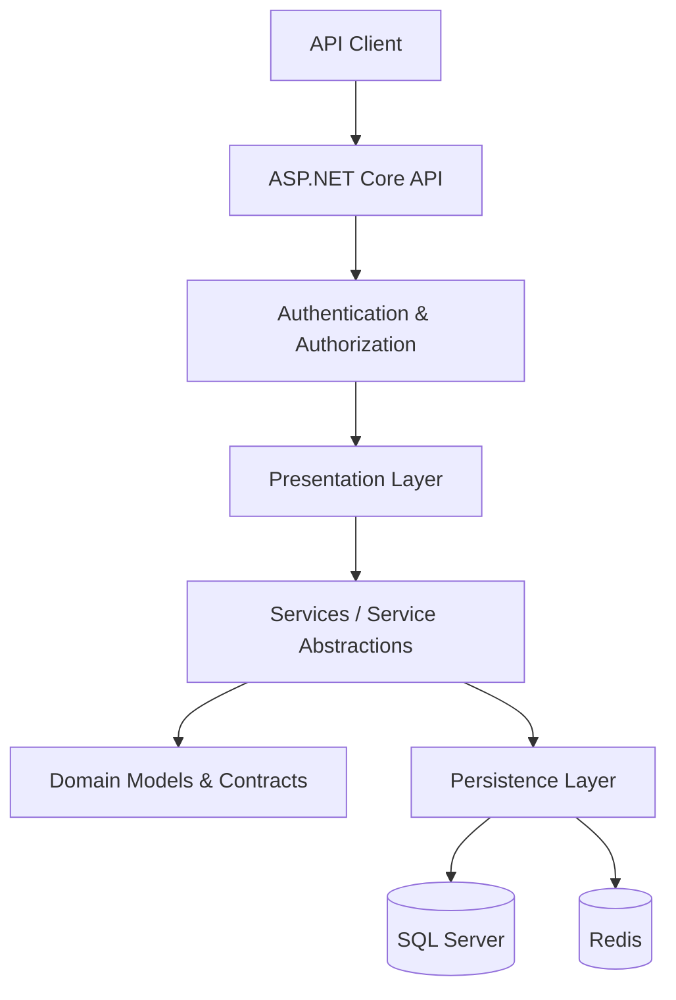

# 🛒 E-Commerce API


An **ASP.NET Core 8 REST API** for an e-commerce backend, organized into separate domain, service, persistence, and API projects. The solution demonstrates modular backend design, dependency injection, database integration, authentication infrastructure, and API documentation.

> **Repository:** [omaresamaboamar/E-Commerce-API](https://github.com/omaresamaboamar/E-Commerce-API)  
> **Branch:** `master`

## ✨ Technical highlights

- **ASP.NET Core Web API (.NET 8)** with controller-based routing.
- **Layered solution design** separating domain contracts, service logic, persistence, and presentation.
- **Entity Framework Core 8** with the SQL Server provider.
- **Redis integration** via `StackExchange.Redis`.
- **JWT bearer authentication infrastructure** with ASP.NET Core authentication and authorization middleware.
- **AutoMapper** for object mapping.
- **Swagger / OpenAPI UI** enabled in the Development environment for API exploration.
- **Centralized exception handling middleware** (`CustomExceptionHandlerMiddlWare`).
- **Dependency injection** organized through service-registration extensions.
- **Startup data seeding** for application and identity data.
- **Static-file support** for assets such as product images.

The items above are based on the solution and configuration files. Endpoint-level business capabilities should be documented only after reviewing the controllers and services.

## 🏗️ Solution architecture

```text
E-Commerce-API/
├── Domain/                 # Domain models and contracts
├── ServicesAbstractions/   # Service contracts
├── Services/               # Application service implementations and mapping
├── Persistence/            # Persistence integration and repositories
├── Presentation/           # API presentation layer
├── Shared/                 # Shared components
├── E-Commerce.Api/         # ASP.NET Core application host
│   ├── Program.cs
│   └── wwwroot/Images/Products/
└── E-Commerce.sln
```

### Request processing (high-level)



This diagram is conceptual; it shows the architectural building blocks and integrations, not a verified call graph for every endpoint.

## 🧰 Technology stack

| Area | Technology |
| --- | --- |
| Language | C# |
| Runtime / API framework | .NET 8 / ASP.NET Core Web API |
| Relational database | SQL Server |
| ORM | Entity Framework Core 8 |
| Cache / key-value store integration | Redis (`StackExchange.Redis`) |
| Authentication | JWT bearer authentication |
| Mapping | AutoMapper |
| API exploration | Swagger / Swashbuckle |
| Dependency management | Built-in ASP.NET Core dependency injection |

## 🚀 Getting started

### Prerequisites

- [.NET 8 SDK](https://dotnet.microsoft.com/download/dotnet/8.0)
- A reachable **SQL Server** instance
- A reachable **Redis** instance
- A development environment such as Visual Studio or VS Code

### 1. Clone the repository

```bash
git clone https://github.com/omaresamaboamar/E-Commerce-API.git
cd E-Commerce-API
```

### 2. Configure your local environment

The API reads configuration for two SQL Server connections, Redis, and JWT settings. Configure these values for your machine instead of committing real secrets into source control.

| Configuration key | Purpose |
| --- | --- |
| `ConnectionStrings:DefaultConnection` | Application SQL Server database |
| `ConnectionStrings:IdentityConnection` | Identity SQL Server database |
| `ConnectionStrings:RedisConnection` | Redis server |
| `JWTOption:SecretKey` | JWT signing key — **secret** |
| `JWTOption:Issuer` | Token issuer |
| `JWTOption:Audience` | Token audience |

For local development, use **.NET User Secrets** or environment variables. Example using User Secrets:

```bash
cd E-Commerce.Api
dotnet user-secrets init
dotnet user-secrets set "ConnectionStrings:DefaultConnection" "<your-sql-server-connection-string>"
dotnet user-secrets set "ConnectionStrings:IdentityConnection" "<your-identity-connection-string>"
dotnet user-secrets set "ConnectionStrings:RedisConnection" "localhost:6379"
dotnet user-secrets set "JWTOption:SecretKey" "<generate-a-new-long-random-secret>"
cd ..
```

> The application calls data-seeding routines on startup. Ensure required databases and schemas are available before running it. Depending on your local state, Entity Framework Core migrations may need to be applied first.

### 3. Restore and build

```bash
dotnet restore E-Commerce.sln
dotnet build E-Commerce.sln
```

### 4. Run the API

```bash
dotnet run --project E-Commerce.Api
```

Use the URL displayed in the terminal. When running in the **Development** environment, open `/swagger` at that URL to explore the exposed endpoints.

## 🔐 Security notes

- Keep JWT signing keys, credentials, and connection secrets out of Git.
- Use environment-specific configuration and secret storage.
- Rotate any signing key that has previously been committed to a public repository.
- Swagger is configured to run in the Development environment.
- Authentication and authorization middleware are registered in the application's pipeline.

## 📚 API documentation

The project uses **Swashbuckle** to generate interactive Swagger/OpenAPI documentation in Development. Once the application starts, visit:

```text
https://localhost:<your-configured-port>/swagger
```

For precise request and response examples, refer to the controller routes and Swagger documentation running against your local instance.

## 🔍 Source reference

This README is grounded in the repository's `master` branch, including `E-Commerce.sln`, `E-Commerce.Api/Program.cs`, relevant `.csproj` files, and API configuration. It intentionally does **not** claim specific catalog, cart, ordering, checkout, or payment endpoints without controller-level verification.

## 👨‍💻 Repository

**[View source code on GitHub](https://github.com/omaresamaboamar/E-Commerce-API)**
